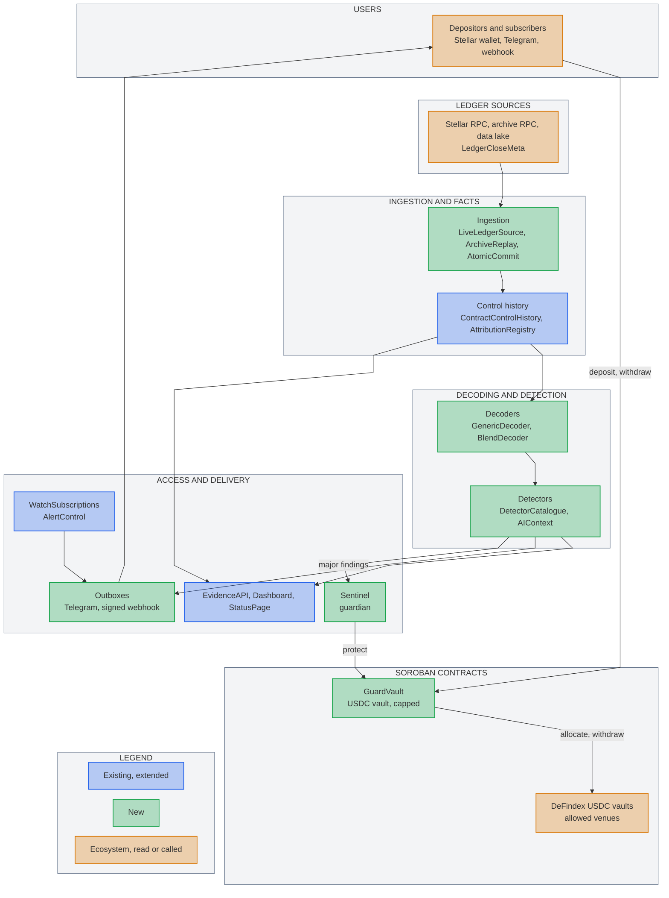
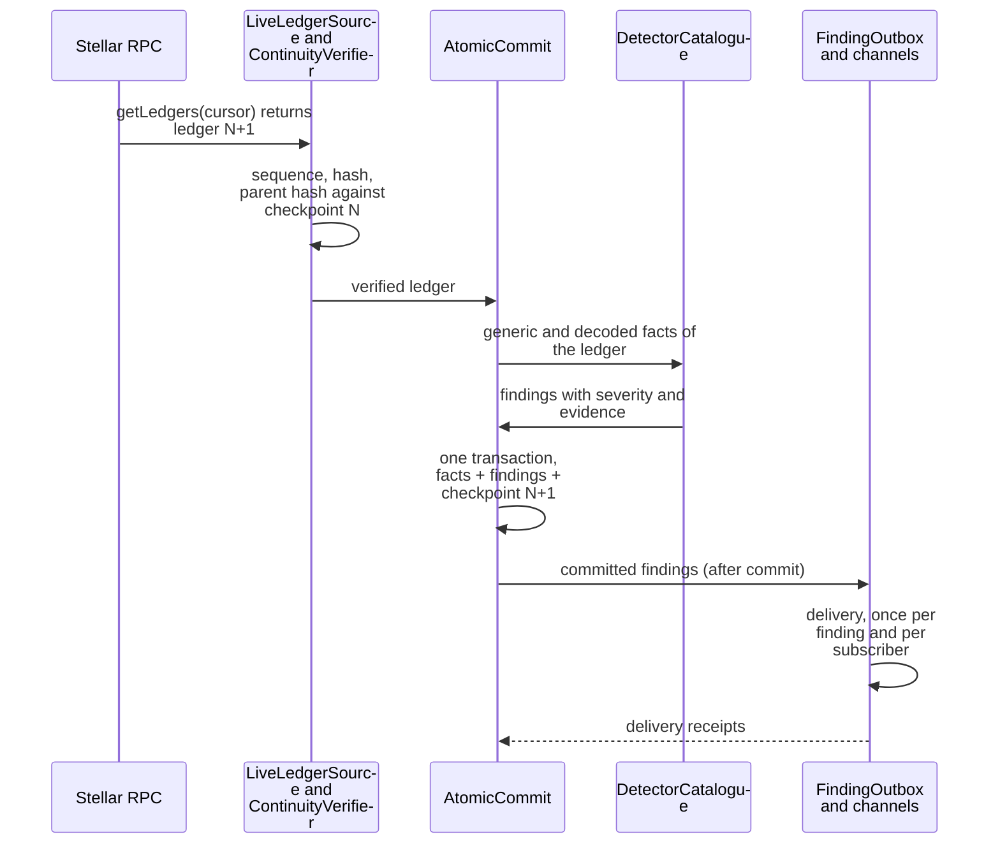
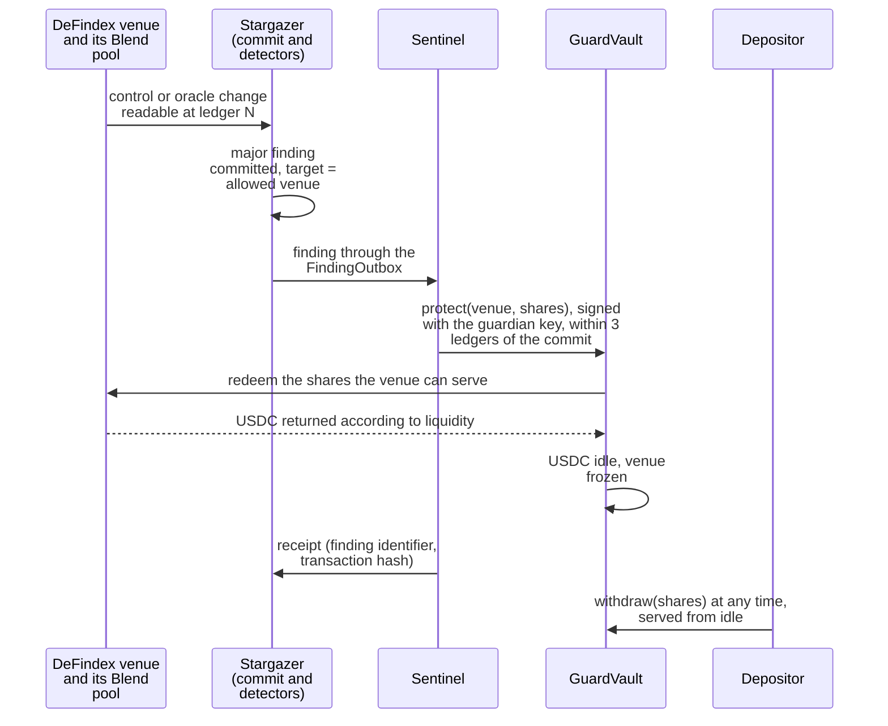

# Stargazer: technical architecture

Stargazer tells you when a contract or a protocol dependency changes on Stellar, why that change matters, and which ledger evidence establishes it. The service reads every Mainnet ledger, extracts verifiable facts from it, keeps the control history of every Soroban contract, applies deterministic rules, and delivers findings over Telegram and signed webhooks. The history can be replayed from the archive; no finding is ever produced without its ledger coordinates. A protection vault, GuardVault, turns a major finding into an action: a depositor's position leaves the affected venue and returns to idle USDC within the following ledgers.

---

## 1. Summary

**Today.** A proof of concept backed by a local Galexie archive: 6.3 million Mainnet ledgers indexed (28 May 2025 to 23 July 2026), a compact index of wallet-to-contract relationships, the executable history of every contract, 36 protocol roots attributed across 7 families, a watcher over 8 controller accounts (Aquarius, Phoenix, Reflector, YieldBlox), a read-only API and a dashboard. The bounded replay of the YieldBlox incident of 22 February 2026 (correlation of wallet-to-pool relationships over the incident ledgers) is reproduced on the archive. Telegram pairing exists; no alert is delivered yet and continuous ingestion is not wired in.

**What we are building.** The same pipeline, fed continuously from Mainnet and exposed publicly: live ingestion over Stellar RPC with catch-up from the archive, atomic commit, a public registry of per-contract control history, generic decoding of any contract that embeds its SEP-48 specification or emits the standard events of the OpenZeppelin libraries, a dedicated decoder for Blend, a public detector catalogue with severity and ledger fixture, subscriptions by protocol, contract or wallet at a chosen level, idempotent delivery over Telegram and signed webhooks, and operations on real hosting with a published cost. And the first on-chain consumer of those findings: GuardVault, a non-custodial USDC vault, capped at launch, spread across DeFindex vaults, whose guardian Sentinel pulls a position back to idle as soon as a major finding touches its venue.

| Who uses it | For what | Through |
|---|---|---|
| A developer or an operations team that depends on a Stellar contract | Learn that a contract their product depends on changed code, admin, signers or oracle, with the evidence | Subscription by protocol or by contract, Telegram or webhook |
| A person with funds on a protocol, or who wants to follow the major protocols | Be warned of a major change, or of any change, on the protocols they pick | Subscription by wallet or by protocol, level "major only" or "everything" |
| An explorer, a wallet, a rules engine | Display or consume a contract's control history and the stream of findings | Versioned public API, signed JSON webhook |
| A USDC depositor in a DeFindex vault | Have their position pulled back to idle automatically when a major finding touches the venue, without waiting to read the alert | GuardVault, deposit and withdrawal at any time, capped at launch |

## 2. What exists, what is new

| Block | Status |
|---|---|
| Galexie archive reader (Rust), compact SQLite index, wallet finalizer, read-only API, dashboard | Running on the archive; to be moved to the target hosting and wired to the live feed |
| Executable history per contract, attributed protocol roots, watcher over 8 classic controllers | Existing; to be extended into a public per-contract registry with reference version and controller state |
| Bounded YieldBlox replay (historical correlation, delivery disabled) | Existing; to be turned into the first detector in the catalogue, with the ledger of the first signal |
| Telegram pairing and alert policies (separate service) | Existing; to be extended to subscriptions by protocol, contract or wallet and to the severity level |
| Live Stellar RPC ingestion, continuity verification, atomic commit, catch-up from the archive | New |
| Replayable module framework (isolated generations, atomic promotion) | New |
| Generic SEP-48 and OpenZeppelin event decoding; dedicated Blend decoder | New |
| Detector catalogue, severity, bounded AI context | New |
| Finding outbox, idempotent Telegram delivery, signed webhook | New |
| Operations: hosting, failover, backup, restore, runbook, status page | New |
| GuardVault (Soroban contract): non-custodial USDC vault, allowed DeFindex venues, caps, `protect`, pause, administration under a delay | New |
| Sentinel: off-chain guardian that turns a major finding into a `protect` transaction | New |

The read tranches (ingestion, history, detection, delivery) never write to the chain. The only contract we write and run in production is GuardVault (§15), with its OpenZeppelin timelock instance, first on testnet, then on Mainnet under a cap; it writes only on the order of a depositor, the curator or the guardian. The test venue used for drills is a vault created from the DeFindex factory, not a contract of ours. The OpenZeppelin test contracts stay on testnet (§22).

## 3. Why Stellar

- **Soroban changes code by replacement.** An admin swaps the Wasm hash of an instance, with no proxy and no ownership standard; nothing in the protocol requires announcing who may do it or when it was done. A depositor or an integrator has nowhere today to read "is this contract still the version I looked at, and who can change it?".
- **The ledger holds all the evidence.** `LedgerCloseMeta` carries entry changes, the `executable_update` system events, Wasm uploads, the signers and thresholds of classic accounts, and contract events. Everything Stargazer asserts replays from the public archive.
- **The YieldBlox incident showed it.** On 22 February 2026, a thin SDEX market, an oracle publication and a pool configuration were enough. Every step was readable on the ledger before the loss; the first high-confidence signal came 69 ledgers before the first outflow of funds.
- **Soroban makes the action composable.** A ledger closes about every five seconds; a committed finding can become a transaction in the next ledger, and a Soroban contract can withdraw a position from a DeFindex vault in the same invocation that returns it to idle. The whole "alert, then act" path lives on the chain, with evidence for every step.
- **What Stellar gains.** A public registry of the control history of Soroban contracts, consumable by explorers and wallets; detectors drawn from real incidents, published with their fixtures; teams and depositors warned of a dependency change before it propagates through composable contracts; and an open vault whose protection rule is public, showing that a Stargazer finding is worth an action.

## 4. Overview

Tranches 1 and 2 build the read column, from ingestion to the outboxes; tranche 2 deploys GuardVault on testnet; tranche 3 puts the service and the vault into production on Mainnet, under a cap.

**Component detail.** The names below are the ones used in the rest of this document and in the milestones.

| Component | Status | Work in this submission |
|---|---|---|
| LiveLedgerSource | new | Mainnet tail over Stellar RPC `getLedgers`, failover to a second provider, catch-up from archive RPC or the data lake, retention bounds read on every cycle |
| ArchiveReplay | existing (Galexie reader), extended | Same normalized ledger boundary as the live path, isolated generations, atomic promotion, delivery disabled |
| ContinuityVerifier | new | Network, sequence, hash and parent hash checked against the committed checkpoint; halt on conflict |
| AtomicCommit | new | Facts, findings, provenance, parser version and checkpoint in a single transaction |
| ContractControlHistory | existing, extended | Wasm lineage, current executable, controller state, reference version, "changed since reference", exposed per contract |
| AttributionRegistry | existing (roots), extended | Time-versioned contract-to-protocol attribution, sources, observation bounds, confidence, factory children |
| GenericDecoder | new | Calls and events decoded from the SEP-48 specification embedded in the Wasm; standard events of the OpenZeppelin Stellar libraries |
| BlendDecoder | new | Dedicated decoder for Blend pools, bound to recognized Wasm hashes; unknown code flagged, never decoded with an old schema; Reflector and the classic SDEX go through the generic decoder |
| DetectorCatalogue | new | Public catalogue: identifier, rule, severity, real ledger fixture, expected output, replay test |
| AIContext | new | Plain-language explanation of a retained finding; changes neither type, nor severity, nor evidence |
| EvidenceAPI v1 | existing, versioned | Coverage, contracts, Wasm history, wallet-to-contract relationships, findings, subscriptions |
| Dashboard, StatusPage | existing, extended | Page per contract, page per protocol, wallet report, finding history, coverage boundary, lag, outages |
| WatchSubscriptions, AlertControl | existing (wallet), extended | Subscription by protocol, contract or wallet, level "major" or "everything", Telegram pairing, webhook keys |
| FindingOutbox, TelegramOutbox, WebhookOutbox | new | Durable outbox after commit, exactly-once delivery per finding and per channel, receipts, retries, webhook signing |
| ProductionOperations | new | Hosting, failover, backup, restore into a clean environment, runbook, monitors from the monitoring plan |
| GuardVault | new | Soroban contract on the OpenZeppelin Stellar libraries: vault shares, USDC only, allowed DeFindex venues, caps, `allocate` and `recall` (curator), `protect` and `pause` (guardian), administration through a 48-hour timelock |
| Sentinel | new | Off-chain guardian: reads committed major findings that target an allowed venue, submits `protect`, publishes the finding identifier and the transaction hash; key limited to the guardian role |

## 5. Ledger sources

One object travels through the whole system, whatever the source: `LedgerCloseMeta`. Only acquisition knows where a ledger came from; decoding, modules and rules never do.

| Need | Source | Fallback |
|---|---|---|
| Live Mainnet tail | Stellar RPC `getLedgers`, authenticated provider | second RPC provider |
| Catch-up of a short gap | RPC `getLedgers` within the retention window | archive RPC `getLedgers` (provider backed by a data lake) |
| Bounded historical replay, fixtures | archive RPC `getLedgers` | Galexie data lake |
| Bulk historical replay, new module | public Galexie data lake (`s3://aws-public-blockchain/v1.1/stellar/ledgers/pubnet`, SEP-54 format) | local Galexie mirror |

Acquisition rules:

- RPC does not stream: LiveLedgerSource polls `getLedgers` by cursor on every new ledger (about 5 seconds) and reads `getHealth().oldestLedger` and the latest available ledger on every cycle. The retention window of an ordinary RPC provider is about 7 days; beyond that, only a provider backed by a data lake serves `getLedgers`.
- A gap is detected when the expected sequence is not the one received. The live path stops advancing, the catch-up source fills `N+1 … M`, reconciliation passes, and the live path resumes at `M+1`. The checkpoint never skips.
- A conflicting hash for an already committed ledger halts ingestion and opens an operator incident. Automatic recovery is for missing data, never for a contradictory history.
- Captive Core is out of scope: RPC with two providers and a data lake cover the live tail, catch-up and replay. A move to Captive Core would only change acquisition.

## 6. Verification and atomic commit

For every ledger:

1. acquire `LedgerCloseMeta`, retain the raw XDR or its content-addressed reference;
2. check the network identifier, the sequence (`checkpoint + 1`), the ledger hash and the previous ledger hash against the committed checkpoint (ContinuityVerifier);
3. walk successful and failed transactions, operations, contract calls, events and entry changes; state changes from a failed transaction are never applied to current state;
4. extract the generic facts (contracts, Wasm, accounts, signers, thresholds), then run the enabled modules;
5. write facts, findings, source provenance, parser version and the new checkpoint in a single transaction (AtomicCommit);
6. acknowledge the ledger to the source only after the commit; delivery reads the outbox after the commit, never before.

Invariants: ledgers are committed strictly in order on the live path; historical workers decode in parallel but commit in deterministic order; every fact carries a network and a ledger coordinate; reprocessing a ledger is idempotent; a parser error keeps the raw record and the error, and continues if the ledger itself remains decodable; a historical replay never enters the live outbox.

## 7. Contract control history

ContractControlHistory is the public core of Stargazer: for every observed Soroban contract, the answer to "which code is running, since when, who can change it, and what has changed since the version I know".

**Recorded facts.**

- Contract creation, Wasm upload (content hash, `contractenvmetav0`, `contractmetav0` entries, `contractspecv0` specification), the instance's executable state, and the time-versioned contract-to-Wasm relationship.
- Every upgrade is confirmed by two signals: the `executable_update` system event (old and new executable) and the contract instance entry change, which proves that the materialized executable changed. A single observed signal yields an internal consistency finding, not an upgrade.
- An upload is not an upgrade: it is a low-severity precursor signal. A restore with the same executable is an availability event, not an upgrade.
- For the classic accounts that control a protocol: master weight, low, medium and high thresholds, signer set, classified policy (single key, weighted with a single-signer path, strict M-of-N, contract, unknown), the minimal signer sets that satisfy the threshold, ledger-to-ledger validity, and the evidencing transaction and operation. The number of signatures on a transaction is not the proof of the policy: the account entry reconstructed before the invocation is.
- For every fact: deterministic identifier, ledger sequence, transaction hash, parser version, old and new state, evidence reference in the archive.

**Reference version.** Every contract carries a reference version: by default, the first executable observed within coverage, or the one a subscriber has pinned. "Changed since reference" is a computed fact (executable, admin, signers, thresholds, oracle), never a judgement. When a Wasm embeds SEP-55 verified build metadata (`source_repo`), it is displayed as provenance information; Stargazer does not verify the build.

**Exposure.** `GET /api/v1/contracts/{id}/history` and a page per contract: Wasm lineage, current executable, reference version, controller state, each entry with ledger, transaction hash and evidence reference. A contract never observed answers "not yet observed", never sample data. An unattributed contract remains queryable under its `C…` address.

## 8. Attribution and decoding

**AttributionRegistry.** Attributing a contract to a protocol is dated evidence, not a truth: every record keeps its source, observation time, confidence and validity bounds (`valid_from`, `valid_to`). An old mapping is never overwritten. The roots published by protocols are extended through their factories and routers (Soroswap pairs, DeFindex vaults, Aquarius and Phoenix pools, Blend deployments), with a review queue for label, Wasm or role conflicts. The versioned export of the registry is public.

**GenericDecoder.** Two levers cover any contract without dedicated code:

- the **SEP-48** interface specification (`contractspecv0`, embedded in the Wasm): functions, types, events and errors are read from the Wasm itself; the invocations and events of a contract that embeds it are decoded by name and argument types;
- the **standard events of the OpenZeppelin Stellar libraries** (`stellar-access`, `stellar-contract-utils`): `ownership_transfer`, `ownership_transfer_completed`, `ownership_renounced`, `role_granted`, `role_revoked`, `role_admin_changed`, `admin_transfer_initiated`, `admin_transfer_completed`, `admin_renounced`, `paused`, `unpaused`. Any contract built on these libraries, starting from the event names of version 0.8.0, enters the detector catalogue the day it is deployed, with no work on our side.

**BlendDecoder.** A single dedicated decoder, where generic facts explain neither the risk nor the intent: Blend pools (pool admin and configuration, status, queued reserves, supply, collateral, borrow, repay, liquidation and auction events). It carries a version, the set of recognized Wasm hashes, the raw event reference and a confidence. An unknown or new Wasm goes through the generic decoder and produces a coverage finding; it is never silently decoded with an old schema. Reflector has no dedicated decoder: its price publications (`set_price`) and admin operations are decoded by name from its SEP-48 specification. Neither does the classic SDEX: offers, fills, normalized price, depth rebuilt from active `OfferEntry` records and concentration are generic facts of the classic ledger, computed for the pairs a detector watches.

## 9. Detector catalogue

A detector is a deterministic rule over committed facts. Every entry in the public catalogue is published with: stable identifier, rule, severity (**major** or **informational**), real ledger fixture (Mainnet coordinates), expected output, and a replay test that runs in continuous integration. A detector without a fixture does not enter the catalogue.

| Identifier | Rule | Severity |
|---|---|---|
| `contract.executable_update` | upgrade confirmed by the system event and the instance change | major |
| `contract.wasm_uploaded` | new Wasm uploaded by a known controller, not yet applied | informational |
| `contract.changed_since_reference` | executable, admin, signers, thresholds or oracle differ from the reference version | major |
| `contract.restored` | instance restored after eviction, same executable | informational |
| `account.threshold_decreased` | a low, medium or high threshold of a controller account decreases | major |
| `account.signer_changed` | signer added, removed or reweighted; hash or pre-authorized signer added | major |
| `account.master_weight_changed` | master weight restored from zero or reduced | major |
| `account.policy_class_changed` | the control policy changes class (strict, weighted, single key, locked) | major |
| `oz.ownership_or_admin_transfer` | `ownership_transfer*`, `admin_transfer_*`, `*_renounced` events | major |
| `oz.role_changed` | `role_granted`, `role_revoked`, `role_admin_changed` | major |
| `oz.paused` | `paused` or `unpaused` | major |
| `governance.executed_payload` | execution of a proposal by a Governor contract, with target, function and arguments decoded from its SEP-48 specification | major |
| `blend.pool_config_changed` | admin, configuration or status change of a Blend pool | major |
| `blend.reserve_outflow` | outflow from a reserve above a published share of the pool's treasury within a ledger window | major |
| `reflector.admin_operation` | admin operation on a Reflector oracle other than a price publication | major |
| `sdex.thin_market_spike` | extreme price move for a negligible notional on a shallow market | informational |
| `oracle.publishes_spike` | an oracle feed publishes a value taken from a manipulated market | major |
| `incident.yieldblox_sequence` | thin-market spike, oracle publication, same asset entering as collateral, reserve outflow | major |
| `coverage.unknown_wasm` | unknown Wasm on an attributed contract: decoder coverage to extend | informational |

Incident detectors never qualify a cause they cannot see: an oracle that faithfully reports a manipulated market is not a compromised oracle; a transfer visible on Stellar does not say how a key was compromised.

**Rules that arm the guardian.** A catalogue entry can carry, on top of its rule and severity, an action: `protect(venue)`. The action fires when the finding is major and its target contract is an allowed GuardVault venue, that venue's strategy, the underlying Blend pool or that pool's oracle. The list of armed rules is public, like the rest of the catalogue, and changes only through the repository, with its tests.

| Armed rule | Triggering target | Action |
|---|---|---|
| `contract.executable_update` | allowed DeFindex vault, its strategy, the underlying Blend pool | `protect(venue)` |
| `contract.changed_since_reference` | allowed DeFindex vault or its strategy: change of Manager, Emergency Manager or Rebalance Manager read through SEP-48 decoding of the admin calls | `protect(venue)` |
| `oz.ownership_or_admin_transfer`, `oz.role_changed`, `oz.paused` | venue or strategy built on the OpenZeppelin libraries (including our test venue on testnet) | `protect(venue)` |
| `account.threshold_decreased`, `account.signer_changed`, `account.policy_class_changed` | controller account of the venue or of the underlying pool | `protect(venue)` |
| `blend.pool_config_changed`, `blend.reserve_outflow` | underlying Blend pool of the venue | `protect(venue)` |
| `oracle.publishes_spike`, `incident.yieldblox_sequence` | oracle or underlying pool of the venue | `protect(venue)` |

An informational finding never arms anything. A finding from a historical replay never enters the outbox, so it never reaches the guardian.

## 10. The YieldBlox replay

The first composite detector in the catalogue replays the sequence of 22 February 2026 on the archive, with delivery disabled. The coordinates are public and the replay command reproduces the sequence identically.

| Ledger | UTC | Expected fact | Detector |
|---|---|---|---|
| 61,339,940 | 21 February 23:38:51 | abnormal USTRY sell offer, near 106.74 USDC | `sdex.thin_market_spike` |
| 61,340,263 | 22 February 00:10:21 | about 0.05 USTRY crosses for about 5.35 USDC | `sdex.thin_market_spike` |
| 61,340,315 | 22 February 00:15:22 | Reflector `set_price` publishes the manipulated value: **first high-confidence signal** | `oracle.publishes_spike` |
| 61,340,381 | 22 February 00:21:51 | about 13,003 USTRY enter the pool as collateral | `incident.yieldblox_sequence` |
| 61,340,384 | 22 February 00:22:09 | about 1,000,197 USDC leave the pool: **first loss** | `blend.reserve_outflow` |
| 61,340,405 | 22 February 00:24:10 | 140,000 USTRY enter the pool | `incident.yieldblox_sequence` |
| 61,340,408 | 22 February 00:24:27 | about 61,249,278 XLM leave the pool | `blend.reserve_outflow` |

The first signal precedes the first loss by 69 ledgers, a little under seven minutes. The composite finding is attributed to the pool configuration (`pool_configuration`), with `Blend core affected = false` and `Reflector unauthorized = false`: neither the Blend core nor Reflector was exploited.

## 11. AI context

AIContext runs after the rule, never before. It receives a retained finding and its evidence, and writes up: what happened, the possible impact, the dependencies touched, the uncertainty, and suggested review steps. It can change neither the event type, nor the severity, nor the evidence fields; an automated test proves this on every release. Every summary links the retained evidence and marks its uncertainty. A subscriber can turn AI context off; the coordinates, parser version, primary sources and coverage limits remain the verifiable record.

## 12. Access: API, dashboard, status

**EvidenceAPI v1.** Read-only, versioned, with a published OpenAPI specification: coverage, contracts and control history, Wasm, wallet-to-contract relationships, protocols and controllers, findings, subscriptions (authenticated). The server opens the databases read-only, bounds page sizes, cuts a request off at its deadline and caps concurrent workers. Invalid input or unavailable data returns an explicit error; no endpoint serves sample data.

**Dashboard.** A page per contract (control history, reference version, evidence), a page per protocol (attributed contracts, controllers, policy state), a wallet dependency report, finding history, and the subscription flow. The dashboard reads only committed data and shows the covered range and the known limits.

**StatusPage.** Current source and provider, oldest and latest ledger available at the source, last ledger fetched, decoded and committed, lag in ledgers and in seconds, catch-up state, parser failures by module and version, outbox age, delivery state per channel, outages over the last 30 days. The "delayed", "unavailable", "partial" and "healthy" states are distinct.

## 13. Subscriptions and delivery

**WatchSubscriptions.** A subscription targets a protocol, a contract or a wallet (its dependencies), at one level: **major only** or **every change**. A subscriber picks their channels: Telegram, webhook, or both. We choose the protocols we decode in depth; the subscriber chooses the ones they follow and their alert level. Subscriptions live in the control database (AlertControl), separate from the evidence databases: a user's policy cannot rewrite a chain fact.

**AlertControl.** The existing Telegram pairing is kept: 15-minute token stored hashed, atomic claim in a private chat, `no-store` and `no-referrer` headers, `/start`, `/list`, `/settings` and `/unwatch` commands. It extends to subscriptions by protocol and by contract and to webhook keys (URL, signing secret, state).

**FindingOutbox.** After a ledger commits, every eligible live finding produces one outbox entry per affected subscription: deterministic identifier (finding, subscription, channel), state, attempts, receipt. A historical replay never writes to the outbox.

**TelegramOutbox.** Idempotent delivery: one outbox entry yields at most one final message, failures are retried with state, and the Telegram receipt is kept. A "major only" subscription receives no informational finding.

**WebhookOutbox.** Same finding, same identifier, as JSON to the subscriber's URL: signed body (Ed25519, Stargazer's public key published, timestamp and finding identifier inside the signed payload), retries with bounded backoff, HTTP receipt kept, deactivation after repeated failures with a notification. The format is stable and versioned so that an explorer, a wallet or a rules engine can consume it without adaptation.

## 14. Replayable modules

A new decoder or detector never blocks the active read generation:

1. the module declares its version and output schema;
2. it replays its required historical range in an isolated staging generation, from the data lake or the mirror, with restartable checkpoints;
3. it catches up with the live tail in a buffer;
4. its promotion gates pass: determinism (two replays, same identifiers), idempotence (zero duplicates), coverage, resources;
5. the generation is promoted atomically; the API picks up the new generation on the next request;
6. throughout the replay, the outboxes record zero messages.

Overlapping archive and live ranges are reconciled against the same materialized state; a divergence blocks promotion.

## 15. The protection vault: GuardVault and Sentinel

GuardVault is the first on-chain consumer of Stargazer findings. It is a non-custodial USDC vault: a depositor puts USDC in, receives shares, and withdraws whenever they want; the vault spreads idle USDC across allowed venues, all of them DeFindex USDC vaults; when a major finding touches a venue, the guardian pulls that venue's position back to idle and freezes the venue. Nothing else: no borrowing, no leverage, no asset conversion, no automatic venue selection.

**Built on the OpenZeppelin Stellar libraries, not reimplemented.** Shares come from the tokenized vault module of `stellar-tokens` (SEP-56, status not final; `total_assets` / `total_shares` accounting, conservative rounding on mint and redeem); pause from the `Pausable` trait of `stellar-contract-utils` and the `#[when_not_paused]` macro of `stellar-macros`; roles from `stellar-access` (AccessControl); upgrade from `stellar-contract-utils` (`Upgradeable`), whose admin is a `stellar-governance` timelock contract. Crate versions are pinned in the repository at the testnet deployment. Our own code is limited to the venue list, the caps, allocation, freezing and `protect`.

**Roles.**

| Role | Who holds it | What it can do | What it cannot do |
|---|---|---|---|
| Admin | Timelock contract (48-hour delay) whose proposer is our multisig account | Change the allowed venue list, the caps, the curator and guardian addresses, propose then execute an upgrade, lift the pause, unfreeze a venue | Anything before 48 hours; every proposal is visible on the chain during the delay |
| Curator | One of our keys, no delay | `allocate(venue, amount)`: from idle to an allowed, unfrozen venue; `recall(venue, amount)`: from a venue back to idle | Touch the caps, the list, the shares, or a frozen venue |
| Guardian | Sentinel's hot key | `protect(venue, shares)`: redeem shares of the venue back to idle and freeze the venue; `pause()`, which blocks deposits and allocations, never withdrawals | Allocate, withdraw to any address other than the vault, change the list or the caps, lift the pause or the freeze |
| Depositor | Any Stellar account | `deposit(amount)` under the caps, `withdraw(shares)` at any time, pause included | Anything else; their shares are tokens, the vault does not know who they are |

**Caps at Mainnet launch.** 25,000 USDC in total and 2,500 USDC per address, written into the contract and published. A deposit that would exceed either is refused. The total cap is the real bound on what the vault can lose; the per-address cap slows concentration without pretending to identify anyone. Any increase is a multisig proposal, visible for 48 hours before it can execute, announced on the status page.

**Accounting.** The vault's value is the idle USDC plus, for every unfrozen venue, the value of the DeFindex shares held, as the DeFindex vault publishes it for its own shares. The vault computes no price and reads no oracle. A frozen venue counts for zero: its shares leave the vault's value the moment it is frozen, and any USDC it returns later goes back to idle for the benefit of the shareholders present at that time. While a venue is frozen, deposits are closed, so that nobody enters at a discount just before funds come back. A withdrawal is served from idle; if idle is not enough, the vault recalls the shortfall from unfrozen venues in list order. Whoever leaves during a freeze gives up their share of what comes back; the rule is public and the status page shows the state of every venue.

**What `protect` does.** `protect(venue, shares)` freezes the venue on the first call, then redeems the requested number of shares from the DeFindex vault; the USDC returned goes to idle; no further allocation to that venue until the admin decides. A DeFindex redemption succeeds or fails as a whole: it is Sentinel that computes, every ledger, the largest number of shares the venue can serve from the published liquidity of its underlying Blend pool, and resubmits `protect` with the remainder while shares remain, until everything is returned or the admin decides. The delay between the finding and the submission is counted in ledgers, never in milliseconds: a ledger closes about every five seconds, and execution depends on the venue's liquidity.

**Sentinel.** An off-chain service, in the same repository as the outboxes, subscribed to the FindingOutbox like one more channel: it only receives committed, live, major findings whose target is an allowed venue or one of its linked contracts (§9). For each finding it builds a `protect(venue, shares)` transaction signed with the guardian key, simulates it, submits it over Stellar RPC, follows its status and records a receipt: finding identifier, ledger sequence of the finding, transaction hash, result. A venue already frozen and fully redeemed produces no transaction. The guardian key lives in the host's secrets manager, carries only the guardian role, and is rotated through an admin proposal; since withdrawals are never blocked, a compromised guardian key can neither move a USDC out of the vault nor stop a depositor from leaving.

**Allowed venues.** The launch list is published with each vault's address and the reason it was chosen; a DeFindex vault whose underlying pool carries an incident recorded in our own catalogue is not eligible. Venue choice and allocation remain human decisions by the curator, informed by the findings; no score decides in their place within this scope.

**Outside the vault.** The vault does not borrow, does not convert, accepts only USDC, and only opens DeFindex USDC vaults; a Blend pool is never a direct venue. The vault takes no fee.

## 16. Operations

ProductionOperations moves the service from the local archive to real hosting: a dedicated server or a virtual machine for ingestion, the API and the outboxes, object storage for the retained raw XDR, and the Galexie mirror as the recovery surface. The provider and machine class are published in the runbook, with the monthly cost.

- **Source failover**: primary RPC provider, second provider, archive RPC, data lake; time-bounded switchover, with no change to parser logic.
- **Backup**: first what cannot be regenerated (registry sources, parser versions, configuration, control database and delivery state), then the retained raw XDR, then the derived databases, which can be rebuilt from the archive.
- **Restore into a clean environment**: rebuilds the read path from the retained evidence and passes the published coverage checks; a recorded drill before launch.
- **Incident runbook**: paging thresholds, response per failure class (source unavailable, missing ledger, hash conflict, unsupported XDR or Wasm, stale service snapshot, delivery channel unavailable, guardian lagging or `protect` transaction rejected), guardian key rotation, maintenance owner, guardian operator and decoder update cadence.

## 17. Guarantees

- Evidence is replayable: every derived fact points to a network, a ledger, a transaction and an archive reference.
- Commits stay ordered: decoding may be concurrent, database state advances in deterministic ledger order.
- Replay is silent: a historical finding can be queried, never delivered as a live alert.
- Unknown stays unknown: an unattributed contract keeps its address; an unknown Wasm never inherits a version label.
- Source and produced state are separate: the read path cannot modify the evidence, the alert policy cannot rewrite a chain fact.
- Severity comes from the rule, never from the AI.
- The guardian can only protect: its key withdraws to the vault's idle balance and pauses deposits and allocations, nothing else; withdrawals are never blocked; no on-chain action starts from an informational finding or from a replay.
- The vault does not decide: it has no price, no oracle, no score; it executes its roles' orders under its caps.
- Every service has a single reason to write, and its own database.
- Pairing and signing secrets never reach logs, analytics or URLs; the bot token and the webhook signing key live in a secrets manager.

## 18. Business model

The public control-history registry and the public findings are free and will stay free: they are the shared reference that explorers, wallets and integrators consume. Paid plans cover what is private or bespoke: private watchlists, custom policies, additional channels, extended retention, dedicated decoders, assisted onboarding, service level. Managed pilots start at $10,000 per year. The monthly operating cost, the maintenance owner and the boundary between the public service and paid plans are published at launch. The protection vault takes no fee within this scope; managed protection (venues, policies and caps specific to a team) will join the paid plans later. Settling subscriptions in USDC on Stellar comes after delivery is proven reliable; it is not in this scope.

## 19. Scope boundaries and what comes next

- Off-chain signals (code repositories, releases, SDK packages, advisories) are not in this scope: they are not readable on the ledger and could not be verified by a replay.
- Pending multisig envelopes, unsigned or partially signed and exchanged off-chain, are invisible to Stargazer; we do not promise to detect them. Stargazer observes execution, not proposals.
- The only dedicated decoder in this submission covers Blend; Reflector, the classic SDEX, Soroswap, DeFindex, Aquarius, Phoenix and FxDAO are attributed and covered by the generic decoder, the classic facts and the control detectors, with their semantic decoders to follow.
- The vault accepts only USDC and only opens DeFindex USDC vaults; it does not borrow, does not convert, does not pick its venues on its own. A per-venue risk score, other assets, other venue families and guided allocation come after this submission, once the "finding, then protection" path is proven on Mainnet.
- Protection depends on the venue's liquidity at the time of the finding: `protect` requests the withdrawal within the following ledgers, execution follows what the venue can return.
- Captive Core, paid plans, USDC payment and team-reviewed enterprise alerts come after this submission.
- Stargazer does not predict an incident; it flags a change readable on the ledger, with its evidence, at the moment it is committed.

## 20. Threat model (STRIDE)

The threat model covers the service, from acquisition to delivery, and the vault with its guardian. Attacker assumption: they control the responses of a data provider, the traffic to the API and the webhooks, every Telegram account except those that have claimed a pairing, they can shape any on-chain state they can legitimately create, they can deposit into the vault and into the venues, and they can try to steal or exhaust the guardian key.

| Threat | Vector | Mitigation |
|---|---|---|
| Spoofing | an RPC provider returns a forged or truncated ledger; a fake webhook impersonates Stargazer; a replayed pairing claim; a fake finding pushed to the guardian | hash chain checked against the checkpoint, conflicting hash = halt; cross-check on a second provider before a catch-up is promoted; Ed25519-signed webhooks with published key, timestamp and identifier in the payload; single-use pairing token, hashed, 15 minutes, private chat only; Sentinel reads only the local FindingOutbox after commit, never an external feed |
| Tampering | modification of the evidence databases; decoder applied to the wrong Wasm; altered attribution registry; state of a failed transaction applied; malicious venue added to the list; vault upgrade without review | content-addressed raw XDR, derived databases rebuildable and compared across versions; decoder bound to recognized Wasm hashes, unknown = coverage finding; versioned registry with source and review queue, never overwritten; state applied for successful executions only; venue list and upgrade only through the 48-hour timelock, proposal visible on the chain, pause available during the delay |
| Repudiation | "this alert was never sent", "this finding did not exist at that ledger", "the guardian acted without a finding" | deterministic fact and finding identifiers, parser version, coordinates; delivery receipts per channel; public reproducible replay; every `protect` transaction published with the identifier and ledger of the finding that triggered it |
| Information disclosure | leak of a pairing token, a webhook secret, the subscription list of a wallet | secrets hashed or in a secrets manager, `no-store`, `no-referrer`, never in logs; pairing status endpoint that answers a generic 404 after expiry; no personal data, a subscription is never public |
| Denial of service | RPC provider unavailable or slow; API flooding; finding storm on one ledger; saturated outbox; Telegram quota exhausted; guardian starved of XLM or RPC at the time of the finding; venue that does not return the USDC; abusive `protect` triggered by a deliberately provoked finding | source failover and catch-up from the archive; rate limiting per key and per address, bounded pages, requests with deadlines; aggregation per subscription and per ledger, bounded backoff, deactivation of a repeatedly failing webhook; lag and outbox age monitored; guardian account funded and monitored, second RPC provider for submission; `protect` resubmitted while shares remain, caps bound the exposure; a venue frozen by mistake costs a lost allocation, never funds, and the admin unfreezes it |
| Elevation of privilege | host access; detection rules or registry changed without review; subscription changed by another Telegram user; guardian key stolen; curator key stolen | hardened host, secrets out of code, named access; rules and registry versioned in the repository, deployed through continuous integration, blocking replay tests; mutations accepted only from the private chat whose identifier equals the paired user, `/unwatch` on the full address; the guardian key can only withdraw to the vault and pause, the curator key can only allocate between allowed venues, neither can move a single USDC out of the vault; rotation through the timelock |

## 21. Monitoring plan

Stargazer applies to itself what it sells. Every monitor has a trigger, a baseline and a response in the runbook.

- Source lag: gap between the latest ledger available at the source and the last one fetched; alert beyond 12 ledgers.
- Parser lag and commit lag: last ledger fetched, decoded, committed; alert if the gap grows over 5 minutes.
- Continuity: unexpected sequence or parent hash; hash conflict = immediate incident.
- Provider availability: `getHealth` or `getLedgers` failure per provider; failover and alert.
- Parser failures by module and version: rate above baseline = coverage to extend.
- Rate of `coverage.unknown_wasm` on attributed contracts.
- Outbox age and attempts: an entry older than 10 minutes alerts.
- Delivery state per channel: consecutive Telegram and webhook failures.
- Host health: disk, memory, object storage space.
- Backup freshness: last successful backup of the control database and the registry sources.
- Service generation and coverage: a projection whose coverage no longer matches its evidence base is refused by the API.
- Guardian lag: gap between the commit of an armed finding and the submission of `protect`; alert beyond 3 ledgers; XLM balance of the guardian account below a published threshold.
- Venue state: frozen venue, partial withdrawal not yet served, gap between the value published by the DeFindex vault and the last one read; any pending timelock proposal is shown on the status page.

## 22. Environments and tests

- **Fixtures**: public Mainnet ranges captured through archive RPC `getLedgers` (including the seven YieldBlox ledgers and a continuous range around them), stored with their hashes; every detector in the catalogue has its own.
- **Testnet**: test contracts we deploy on Stellar testnet with the OpenZeppelin Stellar libraries, to exercise `ownership_transfer`, `role_granted`, `role_revoked`, `paused`, `unpaused` and an upgrade, and prove generic decoding on transactions we generate; GuardVault deployed on testnet with, as its allowed venue, a DeFindex vault we create from their testnet factory; the deposit, allocation, provoked finding, `protect`, withdrawal journeys are replayed end to end with their hashes.
- **Contract**: unit tests of the GuardVault crate (share rounding, caps, roles, freeze, pause, timelock), negative tests on every role (what it cannot do), tests against the real state of a DeFindex vault (partial withdrawal, paused vault), assertions on the authorization tree of `protect` and `allocate`, static analysis of the crate in continuous integration.
- **Replay**: every fixture is replayed twice in continuous integration, identical identifiers, zero duplicates; the overlapping archive and live range converges to the same state.
- **Negatives**: gap, hash conflict, parser failure, invalid input, unavailable data, unknown Wasm, forced delivery failure; each blocks what it must block.
- **Continuous integration**: build, tests, coverage, API contract tests, fixture replay, the test proving that the AI changes neither type, nor severity, nor evidence.
- **Mainnet**: live ingestion observed over a continuous window before launch, outages listed on the status page; deliveries to Telegram channels and a webhook receiver that we operate, receipts published; GuardVault under a cap, journeys with our own funds, and protection drills on a test venue we operate (vault created from the DeFindex factory), every transaction published with the finding that triggered it.

## 23. Versions (November 2026)

- Stellar Mainnet on protocol 29; the reader is on `stellar-xdr` 27 today and moves to the major version of the target network's protocol with live ingestion.
- Stellar RPC: `getLedgers` by cursor, no streaming; about 7 days of retention on an ordinary provider; deep history only on a provider backed by a data lake, bounded by `getHealth().oldestLedger`.
- Public Galexie data lake: `s3://aws-public-blockchain/v1.1/stellar/ledgers/pubnet`, SEP-54 format.
- SEP-48 (Contract Interface Specification): active, version 1.1.0. SEP-55 (Contract Build Verification): status not final, displayed as provenance only.
- OpenZeppelin Stellar libraries `stellar-access` and `stellar-contract-utils` 0.8.0: the event names of the catalogue; `stellar-tokens` (tokenized vault module), `stellar-contract-utils` (`Pausable`, `Upgradeable`), `stellar-access` and `stellar-governance` (timelock) for GuardVault, at the current version at the time of the testnet deployment.
- USDC on Stellar: classic asset issued by Circle (`GA5ZSEJYB37JRC5AVCIA5MOP4RHTM335X2KGX3IHOJAPP5RE34K4KZVN`), handled by the vault through its Stellar Asset Contract.
- DeFindex: Soroban vaults deployed through a factory, vault shares, Manager, Rebalance Manager, Emergency Manager and Fee Receiver roles, strategies into Blend pools; GuardVault only calls a vault's `deposit` and `withdraw` and reads the value of its shares.
- Services: Rust (reader, API, alert control), SvelteKit (website and dashboard), Node 22 (controller watcher), SQLite in WAL mode with atomically published generations.

## References

- Repository: https://github.com/FernoLabs/stargazer
- Documentation: https://stargazer.ferno.ag/docs
- Stellar RPC `getLedgers`: https://developers.stellar.org/docs/data/apis/rpc/api-reference/methods/getLedgers
- Data lake integration and archive `getLedgers`: https://developers.stellar.org/docs/data/apis/rpc/admin-guide/data-lake-integration
- Galexie: https://developers.stellar.org/docs/data/indexers/build-your-own/galexie
- SEP-48: https://github.com/stellar/stellar-protocol/blob/master/ecosystem/sep-0048.md
- SEP-55: https://github.com/stellar/stellar-protocol/blob/master/ecosystem/sep-0055.md
- OpenZeppelin Stellar Contracts: https://github.com/OpenZeppelin/stellar-contracts
- DeFindex (contracts and factory): https://github.com/paltalabs/defindex
- SEP-56 (tokenized vaults): https://github.com/stellar/stellar-protocol/blob/master/ecosystem/sep-0056.md
- Threat modeling: https://developers.stellar.org/docs/build/security-docs/threat-modeling
- Monitoring plan template: https://developers.stellar.org/docs/build/security-docs/monitoring/monitoring-template-builders
- YieldBlox incident analysis: https://blocksec.com/blog/yieldblox-dao-incident-on-stellar-oracle-misconfiguration-enabled-a-10m-drain
